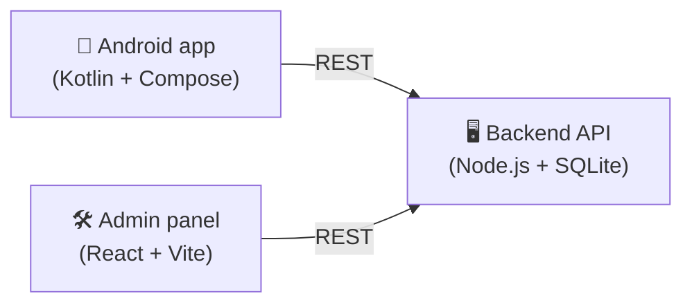

<h1 align="center">🚌 Where Is My Bus</h1>

<p align="center"><b>Live bus tracking for Tamil Nadu town & long-distance routes — Android app, Node.js backend and React admin panel. Bilingual English / தமிழ்.</b></p>

<p align="center">
       
</p>

## 🧩 System overview



| Part | Folder | Description |
|---|---|---|
| Android app | [`app/`](app) | Passenger app — nearest stop, live ETAs, route timeline, favorites, news |
| Backend | [`backend/`](backend) | REST API for stops, routes, announcements, reports, journey search |
| Admin panel | [`admin-panel/`](admin-panel) | Web console to manage routes/stops, bulk CSV upload, review feedback |

---
Native Android app (Kotlin + Jetpack Compose) for tracking buses, built
against simulated/mock data so the full UI and flow can be exercised without
a live transit backend. Modeled on real Tamil Nadu town-bus routes, bilingual
in English and Tamil.

## Features

- **Home** — auto-detects your device location (via the platform
  `LocationManager`, no Google Play Services needed) and suggests the
  nearest bus stop and the routes serving it, with a live ETA list.
  Falls back to a default stop if location isn't available yet.
- **Live route timeline** — tap any route to see its full stop-by-stop
  timeline: scheduled vs. expected time per stop, which stops are passed,
  a "bus is here" marker between stops, and Alert me / Share / I'm on it
  actions. Long-distance routes (admin-tagged, e.g. "515: Tirupattur →
  Karaikudi") show distance and a "via" line instead of a plain stop count.
- **Search** — filter routes and stops by name; each stop shows its
  village/city/district as set in the admin panel.
- **Stop detail** — per-route ETA list for a favorited stop.
- **Favorites** — starred stops with an inline ETA summary; demonstrates a
  local notification firing when a favorited bus is about to arrive.
- **English / தமிழ்** — toggle in the header switches all UI chrome and
  stop/route names instantly (no activity restart).
- **News & updates** — a News tab showing admin-posted announcements
  (service alerts, new stops, etc.), newest first.
- **Feedback** — a form (under More) that posts straight to the backend; it
  shows up in the admin panel's Reports as a "Feedback" item.
- **Support** — contact info and FAQ (under More).

- **Synced with the admin panel** — on launch (and via the Refresh control
  in the Home header), the app pulls the current stops/routes from the
  [backend](backend), so edits made in the [admin panel](admin-panel)
  reach the app without a rebuild. Falls back to the bundled seed data if
  the backend isn't reachable — the app always works offline.

All data starts from `data/MockBusRepository.kt`'s bundled seed, then
optionally refreshes from the backend. Routes have a `LiveMode`:
- **LIVE** — a simulated bus actually walks the route's stops every 3
  seconds at a fixed speed, so ETAs and the timeline count down for real.
- **RECENT** — a fixed "seen N min ago" value, as if passenger sharing went
  stale.
- **TIMETABLE** — a fixed schedule-based ETA, no live tracking at all.

This models how the real app would behave when crowdsourced location
sharing is live, stale, or unavailable for a given route — not just a color
swap on otherwise-identical data.

Stops/routes include the Coimbatore network (70A, 45, 12, 96) and a longer
example route, **515: Tirupattur → Pillayarpatti → Karaikudi**, to
demonstrate the nearest-stop logic working for someone located between two
endpoints, not just at a named city.

## Project layout

```
app/src/main/java/com/wheresmybus/app/
  data/            Stop/BusRoute/BusLocation/Eta/RouteTimeline models + MockBusRepository + Geo helpers
  location/        DeviceLocation — platform LocationManager wrapper (no Play Services)
  remote/          ApiClient — fetches stops/routes from the backend (plain HttpURLConnection + org.json)
  ui/
    theme/         Material3 theme
    strings/       Bilingual (EN/TA) in-app string provider
    home/          Home screen (nearest stop + buses near you)
    routedetail/   Live route timeline screen
    search/        Search screen
    stopdetail/    Stop detail / ETA screen
    favorites/     Favorites screen
    news/          News & updates feed (admin-posted announcements)
    more/          More tab (entry point for Feedback/Support)
    feedback/      Feedback form, posts to the backend
    support/       Contact info + FAQ
    nav/           Bottom-nav + NavHost wiring
    BusViewModel.kt
  notification/    Local "bus arriving" notification helper
  MainActivity.kt
```

## Build & run

Requires JDK 21 and the Android SDK (already configured in
`local.properties` → `sdk.dir`). The Gradle wrapper handles the rest.

```
./gradlew assembleDebug
```

Install on a connected device/emulator:

```
./gradlew installDebug
```

Or open the folder in Android Studio and hit Run. On first launch the app
asks for location and notification permissions; denying location just keeps
the default fallback stop instead of a live nearest-stop suggestion.

To see edits from the admin panel reach the app: run `backend` (`npm
start`), make a change in the admin panel, then tap **Refresh** in the
app's Home header (or relaunch the app). On an emulator this works out of
the box (`10.0.2.2` is the emulator's alias for your host machine); on a
physical device, update `remote/RemoteConfig.kt`'s `BASE_URL` to your
machine's LAN IP first.

## Next steps (post mock-data phase)

- Have the backend own live bus GPS positions too (currently the bus
  movement simulation is still local to the app — only the route/stop
  *catalog* syncs from the backend).
- Persist favorites (currently in-memory only) with DataStore.
- Wire "I'm on it" / "I'm on a bus" to actually broadcast the device's
  location to the backend — currently a local-only UI toggle.


---

## 👨‍💻 Author

**Kishore** — B.Tech Computer Science · Software developer building practical apps for everyday problems in Tamil Nadu and India.

- GitHub: [@joker7866](https://github.com/joker7866)

<p align="center"><sub>⭐ If you find this project useful, consider giving it a star!</sub></p>
